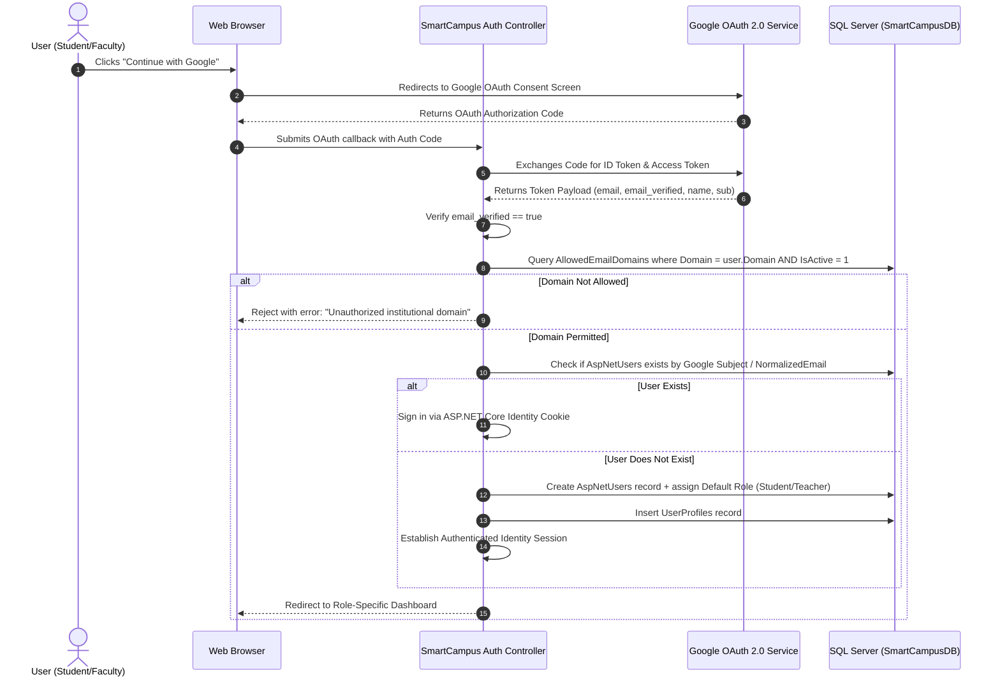
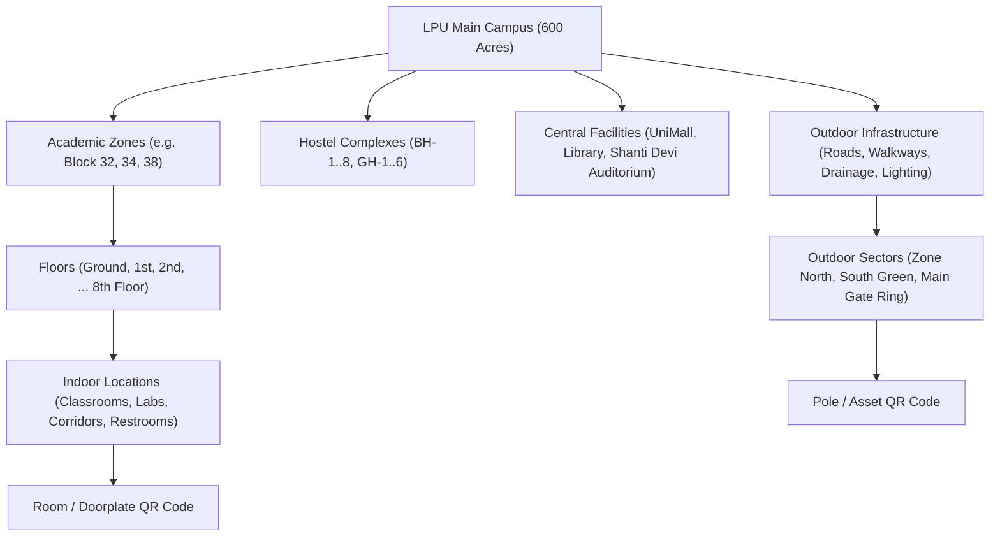
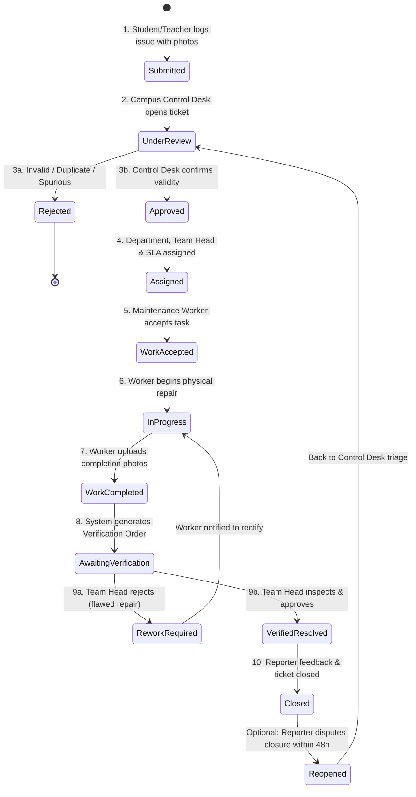

# SmartCampus — Product Requirements Document (PRD)

**Project:** SmartCampus — Intelligent Campus Issue Reporting, Workforce Allocation & Resolution Verification System  
**Reference Institution:** Lovely Professional University (LPU), Punjab, India (600+ Acres, 60+ Blocks)  
**Version:** 1.0.0 (Phase 1 Specification)  
**Status:** In Progress — Phase 1 (Planning & Requirements)  
**Target Platform:** ASP.NET Core MVC (.NET 10 LTS), Entity Framework Core 10, SQL Server (`SmartCampusDB`), Bootstrap 5, Leaflet, Chart.js

---

## 1. Executive Summary & Problem Statement

Large-scale university campuses like Lovely Professional University (LPU)—spanning over 600 acres, 60+ multi-story academic blocks, 14+ residential hostels, central facilities, and miles of road and utility infrastructure—face immense operational challenges in facility maintenance:
- **Communication Chasm:** Students and faculty encounter broken infrastructure (HVAC failures, water leaks, electrical hazards, broken lab furniture) but lack a transparent, centralized system to report and track issues.
- **Manual & Opaque Allocation:** Maintenance requests are handled via disparate WhatsApp messages, paper logbooks, or phone calls, resulting in uneven worker workload, lost requests, and no accountability.
- **The "False Resolution" Trap:** In traditional facilities management, workers self-report completion without independent quality checks. Recurring complaints occur because work was poorly executed or never performed.
- **SLA Neglect:** Without automated deadline tracking and escalation thresholds, critical safety issues (e.g., exposed high-voltage wiring, sewage leaks) languish unattended.

**SmartCampus** solves these problems by providing an end-to-end, role-governed digital ecosystem with dynamic spatial hierarchy, rule-assisted workforce allocation, automated SLA monitoring, and a mandatory **Independent Verification Gate** (`Work Completed != Resolved`).

---

## 2. Core Architecture & System Boundaries

### 2.1 Technology Stack Matrix
| Layer | Technology | Specification / Version |
| :--- | :--- | :--- |
| **Frontend UI** | HTML5, CSS3, JavaScript (ES6+) | Vanilla JS, Bootstrap 5.3, Bootstrap Icons |
| **Backend Framework** | ASP.NET Core MVC | .NET 10 LTS (`net10.0`) |
| **Data Access / ORM** | Entity Framework Core | EF Core 10 with Code-First Migrations |
| **Database** | Microsoft SQL Server | `SmartCampusDB` (Relational Schema, Foreign Keys, Indexes) |
| **Authentication & AuthZ**| ASP.NET Core Identity + Google OAuth 2.0 | Server-side token validation, institutional email domain whitelist |
| **Geospatial & Mapping** | Leaflet.js + OpenStreetMap | Interactive campus map, building polygons/markers, GPS capture |
| **Data Visualization** | Chart.js | Operational analytics, SLA compliance, department load |
| **QR Code Engine** | QRCoder (.NET library) | Dynamic QR generation for rooms, blocks, and outdoor assets |
| **Future Extensions** | SignalR + Python / FastAPI | Live real-time socket updates & AI vision classification |

### 2.2 System Non-Goals
1. **Emergency Dispatch Replacement:** SmartCampus is not an alternative to emergency 112/911, fire alarms, or active police dispatch. The UI must explicitly provide prominent emergency hotline contacts for immediate life-threatening events.
2. **Payroll / Financial Accounting:** While worker hours and resolution times are logged, SmartCampus does not compute wage slips, contractor disbursements, or university fiscal ledger reconciliations.
3. **Hardcoded Building Topology:** The system must never hardcode building names, room numbers, or departments in code. All spatial data must be dynamic to allow portability to other campuses.

---

## 3. User Roles & Access Control Matrix (RBAC)

SmartCampus defines 5 mutually exclusive operational roles:

| Role ID | Role Name | Primary Responsibility | Scope of Visibility | Privilege Level |
| :--- | :--- | :--- | :--- | :--- |
| **R1** | **Student / Teacher** (Reporter) | Submit complaints, upload photos, track resolution timeline, rate verified work | Own submitted complaints only | Standard (Self-Registration via Google) |
| **R2** | **Campus Administrator** (Control Desk) | Triage complaints, approve/reject, set priority & SLA, dispatch to departments | All campus complaints & department queues | High (Staff Authorization Required) |
| **R3** | **Department Supervisor** (Team Head) | Manage trade teams, allocate technicians, inspect completed work, sign off verification | Department work orders, team workload & inspections | Elevated (Admin Assigned) |
| **R4** | **Maintenance Worker** (Technician) | Accept tasks, update field progress, submit completion photographs & notes | Assigned work orders and tasks only | Operational (Admin / Supervisor Assigned) |
| **R5** | **Super Administrator** | System config, role assignments, campus hierarchy, SLA policies, global audit logs | System-wide configuration & analytics | Maximum (Root Level Authority) |

### 3.1 Strict Security Rules
1. **Separation of Verification (Cardinal Rule):** Under no circumstance may a Maintenance Worker approve, verify, or close their own work order.
2. **Controlled Elevation:** Self-registration assigns only the `Student/Teacher` role based on approved email domains. Elevating an account to Worker, Supervisor, Administrator, or Super Admin requires explicit action by an authorized Administrator.
3. **Strict Data Scoping:** Workers cannot browse global complaints; supervisors cannot inspect outside their department's work orders unless granted cross-departmental admin rights.

---

## 4. Google OAuth 2.0 & Institutional Eligibility Specification

### 4.1 Configurable Domain Rules
- Table `AllowedEmailDomains` stores allowed domains (e.g., `lpu.co.in`, `lpu.in`, `gmail.com` for prototype testing).
- Each domain has an `IsActive` flag and an `AllowedRole` default (default: `StudentTeacher`).
- Super Administrators can toggle domain access without application recompilation.

---

## 5. Campus Location & Spatial Hierarchy

### 5.1 Dynamic Location Hierarchy
1. **Building/Block:** Dynamic entity containing Code (e.g., "BLK-32"), Name ("School of Computer Science"), Latitude, Longitude, Total Floors, Zone Type (Academic, Residential, Administrative, Commercial, Recreational).
2. **Floor:** Associated with a Building, stores Floor Number (-1 for Basement, 0 for Ground, 1..N), Floor Plan image reference.
3. **Location (Indoor / Outdoor):**
   - Indoor: Room Number, Room Type (Classroom, Computer Lab, Faculty Cabin, Washroom, Corridor, Stairwell).
   - Outdoor: Zone Name, Landmark, Sector, Latitude, Longitude, Asset Identifier (e.g., Streetlight Pole #SL-32-04).
4. **QR Code Integration:** Unique GUID encoded into URL: `https://smartcampus.lpu.in/Report?locId={GUID}`. Scanning automatically populates Building, Floor, and Room.

---

## 6. Complete 10-Stage Complaint Lifecycle

### 6.1 State Transition Governance Matrix
| From Status | To Status | Triggered By | Required Evidence / Input |
| :--- | :--- | :--- | :--- |
| `None` | `Submitted` | Student / Teacher | Category, Location, Description, 1-3 Photos |
| `Submitted` | `UnderReview` | Control Desk | Desk Officer views submission |
| `UnderReview` | `Approved` | Control Desk | Priority set, SLA assigned, Department selected |
| `UnderReview` | `Rejected` | Control Desk | Mandatory rejection justification remark |
| `Approved` | `Assigned` | Control Desk / Supervisor | Work Order generated, Team & Worker allocated |
| `Assigned` | `WorkAccepted` | Maintenance Worker | Worker acknowledges dispatch |
| `WorkAccepted` | `InProgress` | Maintenance Worker | Worker initiates work on-site |
| `InProgress` | `WorkCompleted` | Maintenance Worker | **Mandatory:** Completion photo(s) + technician notes |
| `WorkCompleted` | `AwaitingVerification`| Automated System | System dispatches notification to Team Head |
| `AwaitingVerification` | `ReworkRequired` | Team Head | **Mandatory:** Rejection reasons + defect inspection photos |
| `AwaitingVerification` | `VerifiedResolved` | Team Head | **Mandatory:** Verification photo(s) + inspection sign-off |
| `VerifiedResolved` | `Closed` | System / Control Desk | Automated after reporter feedback or 48-hour timeout |
| `Closed` | `Reopened` | Student / Teacher | Valid grievance statement (within 48 hours) |

---

## 7. Workforce Allocation & Work Order Engine

### 7.1 Multi-Work Order Capability
A complex incident (e.g., burst pipe in server room damaging ceiling and wiring) generates multiple independent `WorkOrders`:
- `WorkOrder #1` -> Department: Plumbing -> Supervisor: Plumbing Team Head -> Technicians: Plumber A
- `WorkOrder #2` -> Department: Electrical -> Supervisor: Electrical Team Head -> Technicians: Electrician B, C
- `WorkOrder #3` -> Department: Carpentry -> Supervisor: Carpentry Team Head -> Technicians: Carpenter D

The parent `Complaint` cannot transition to `VerifiedResolved` until **ALL** child work orders have reached `VerifiedResolved`.

### 7.2 Allocation Recommendation Rules
1. **Trade Matching:** Complaint Category (`Electrical`, `Plumbing`, `HVAC`, `Civil/Carpentry`, `Network/IT`, `Sanitation`) automatically filters target department.
2. **Team Load Balancing:** The system calculates each worker's active workload (`ActiveWorkOrdersCount = InProgress + WorkAccepted`).
3. **Availability State:** Technicians marked `OnLeave` or `Overloaded` (> 3 active tasks) are flagged.

---

## 8. SLA and Deadline Escalation Matrix

### 8.1 Default SLA Profiles
| Priority Level | Response Deadline | Work-Start Target | Resolution Deadline | Prototype Benchmark Issues |
| :--- | :--- | :--- | :--- | :--- |
| **Critical** | 15 Minutes | 30 Minutes | **1 Hour** | High voltage sparking, gas smell, raw sewage overflow, lift entrapment |
| **High** | 1 Hour | 2 Hours | **6 Hours** | Main water line leak, server room AC failure, corridor blackout |
| **Medium** | 4 Hours | 8 Hours | **24 Hours** | Broken classroom desk, faulty fan, non-draining washbasin |
| **Low** | 12 Hours | 24 Hours | **72 Hours** | Minor wall paint chipping, loose bulletin board, cosmetic fixtures |

### 8.2 Automated Multi-Tier Escalation Thresholds
- **Tier 1 (50% Elapsed):** Automated in-app notification & SMS/Email reminder to Assigned Worker.
- **Tier 2 (75% Elapsed):** Warning notification dispatched to Department Supervisor (Team Head).
- **Tier 3 (100% Breached):** Urgent escalation alert dispatched to Campus Control Desk & Campus Administrator with `IsOverdue = true` badge logged in `SLAEscalations` table.

---

## 9. Comprehensive Database Architecture (`SmartCampusDB`)

The database consists of 11 relational modules:
1. **Identity & Auth Module:** `AspNetUsers`, `AspNetRoles`, `AspNetUserRoles`, `AllowedEmailDomains`, `UserProfiles`
2. **Campus Topology Module:** `Buildings`, `Floors`, `Locations`, `LocationQRCodes`
3. **Issue Catalog Module:** `IssueCategories`, `IssueSubcategories`, `Priorities`, `SLAPolicies`
4. **Workforce & Department Module:** `Departments`, `Teams`, `TeamMembers`, `Skills`, `WorkerSkills`
5. **Complaint Management Module:** `Complaints`, `ComplaintImages`, `ComplaintHistory`
6. **Work Order Management Module:** `WorkOrders`, `WorkOrderAssignments`, `WorkOrderLogs`
7. **Independent Verification Module:** `Verifications`, `VerificationImages`
8. **SLA Monitoring Module:** `SLAEscalations`, `SLABreachAudit`
9. **Feedback & Quality Module:** `ComplaintFeedbacks`
10. **System Notification Module:** `Notifications`
11. **System Audit Module:** `AuditLogs`

---

## 10. Sequential 15-Phase Development Roadmap & Checklists

- [x] **Phase 1: Planning and Requirements**
  - [x] Finalize Software Requirements Specification (SRS) (`docs/SRS.md`)
  - [x] Generate Detailed Use-Case Specifications & Workflow Diagrams (`docs/USE_CASE_SPECIFICATION.md`)
  - [x] Finalize Database Entity-Relationship Diagram & Schema Catalog (`docs/DATABASE_ERD.md`)
  - [x] Define Configurable Google OAuth & Institutional Domain Whitelist rules
  - [x] Establish Initial SLA policies and priority levels
- [x] **Phase 2: Environment and Project Setup**
  - [x] Verify .NET 10 LTS SDK and Visual Studio 2022 compatibility
  - [x] Scaffold ASP.NET Core MVC solution with clean Clean/N-Tier or Feature-Folder structure
  - [x] Install EF Core 10, SQL Server driver, and Identity packages
  - [x] Configure `appsettings.json` connection strings for `SmartCampusDB`
  - [x] Set up Git repository and `.gitignore`
- [x] **Phase 3: Database Development & Migrations**
  - [x] Define all Domain Entities with EF Core Fluent API configurations
  - [x] Configure ApplicationDbContext with indexes and cascading rules
  - [x] Build Data Seeder with LPU-specific reference buildings (Block 32, 34, 38, BH-1, GH-1, Central Library), departments, categories, and test user profiles
  - [x] Seed initial roles and configuration
- [x] **Phase 4: Google Authentication & Authorization (RBAC)**
  - [x] Configure Google OAuth 2.0 Client credentials in backend
  - [x] Implement server-side Google token verification and `email_verified` check
  - [x] Implement `AllowedEmailDomains` validation filter (`IEmailDomainValidator`)
  - [x] Scaffold ASP.NET Core Identity authentication cookies and claims
  - [x] Implement role-based authorization policies and custom dashboard redirects
  - [x] Implement LPU UMS styled login view with 1-click evaluation role switcher
- [x] **Phase 5: Campus & Location Management**
  - [x] Admin CRUD for Buildings, Floors, and Rooms/Outdoor Locations
  - [x] Geo-coordinate (Latitude/Longitude) inputs for OpenStreetMap integration
  - [x] Dynamic QR Code generation for each location using QRCoder
  - [x] Location search & autocomplete API (`LocationApiController`)
  - [x] Interactive Leaflet GIS campus map with live building markers
- [x] **Phase 6: Student & Teacher Complaint Module**
  - [x] Responsive Complaint Submission Form with Bootstrap 5
  - [x] Client & server-side photo upload validation (MIME-type, size limits, SHA-256 integrity)
  - [x] "My Complaints" portal with live status pill badges
  - [x] Visual Complaint Timeline showing audit history
  - [x] Issue rating and feedback form upon closure with 48h dispute loop
- [x] **Phase 7: Campus Control Desk (Administrator)**
  - [x] Real-time complaint triage queue (Filter by Building, Department, Priority, Status)
  - [x] Action modals for Approve, Reject (with reason), and Priority Assignment
  - [x] Duplicate complaint detection heuristic (same location + category within 48h)
  - [x] Department routing and SLA deadline calculation
- [x] **Phase 8: Department & Workforce Management**
  - [x] Department, Team, and Trade Skill configuration
  - [x] Worker directory with skill tagging and active workload counters
  - [x] Supervisor (Team Head) assignment to teams
  - [x] Worker availability toggle (Available, On Leave, Busy)
- [x] **Phase 9: Work Orders & Manpower Allocation**
  - [x] Automatic and manual Work Order generation from approved complaints
  - [x] Manpower allocation UI: assigning 1 or more technicians to a Work Order
  - [x] Technician portal ("My Assigned Tasks") with field action cards
  - [x] Task acceptance and status transitions (`WorkAccepted`, `InProgress`)
- [x] **Phase 10: Independent Verification Gate (Differentiator)**
  - [x] Worker completion workflow: mandatory upload of after-repair photographs and notes
  - [x] System status change to `AwaitingVerification`
  - [x] Supervisor inspection portal: side-by-side comparison of "Issue Photo" vs "Completion Photo"
  - [x] Verification sign-off: Approve (with inspector photo) or Reject with Rework order
  - [x] Enforce backend rule: Worker cannot verify own work
- [x] **Phase 11: SLA Monitoring & Escalation Engine**
  - [x] Background Worker / Hosted Service calculating elapsed percentage of SLA (`SLAEngineHostedService`)
  - [x] Automated generation of Tier 1 (50%), Tier 2 (75%), and Tier 3 (100%) escalations
  - [x] SLA breach dashboard for Control Desk (`SLAMonitorController`)
- [x] **Phase 12: Interactive Campus Map & QR Integration**
  - [x] Leaflet.js + OpenStreetMap integration with custom LPU campus bounds
  - [x] Interactive pins colored by complaint urgency/status
  - [x] QR scanner camera interface for instant location lookup and pre-filled complaint form
- [x] **Phase 13: Operations Analytics & Notifications**
  - [x] Chart.js dashboards: Resolution rate, Mean Time to Resolve (MTTR), SLA compliance %
  - [x] Department performance comparison charts
  - [x] High-frequency problem area heatmaps (top buildings/blocks with complaints)
  - [x] In-app notification center for all 5 roles
- [x] **Phase 14: Advanced Optimization & Real-Time Features**
  - [x] Intelligent department recommender based on issue keywords
  - [x] Workload auto-balancing suggestion algorithm
  - [x] SignalR live push notification channel
- [x] **Phase 15: Rigorous Verification, Hardening & Deployment**
  - [x] End-to-end integration testing of all 10 lifecycle stages
  - [x] Security audit: File upload sandboxing, anti-forgery tokens, XSS/SQLi sanitization, RBAC boundary checks
  - [x] Seed full pilot data for LPU campus (Academic + Hostel blocks)
  - [x] Production build and comprehensive project documentation
