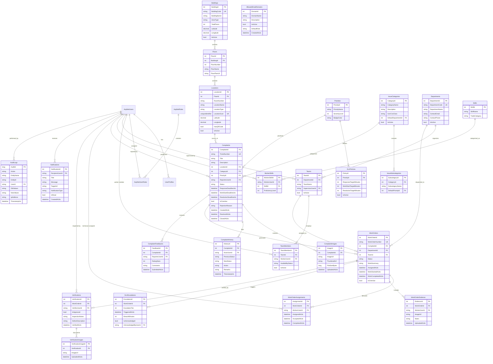

# Database Entity-Relationship Diagram & Schema Specification
## SmartCampus: Intelligent Campus Issue Reporting, Workforce Allocation & Resolution Verification System

**Document Version:** 1.0.0  
**Database Engine:** Microsoft SQL Server 2022 / LocalDB  
**Database Name:** `SmartCampusDB`  
**ORM:** Entity Framework Core 10 (Code-First with Fluent API)  

---

## 1. Complete Entity-Relationship Diagram (ERD)



---

## 2. Table Data Dictionaries & Constraints

### 2.1 Module 1: Authentication & Institutional Access

#### `AllowedEmailDomains`
Stores permitted institutional domains for Google OAuth validation.
| Column | Type | Constraints | Description |
| :--- | :--- | :--- | :--- |
| `DomainId` | `int` | PK, Identity(1,1) | Unique identifier |
| `DomainName` | `nvarchar(150)` | NOT NULL, Unique | e.g., `lpu.co.in`, `lpu.in`, `gmail.com` |
| `Description` | `nvarchar(255)` | NULL | Administrative notes (e.g. "Official Faculty Domain") |
| `IsActive` | `bit` | NOT NULL, Default(1) | Whitelist status toggle |
| `DefaultRole` | `nvarchar(50)` | NOT NULL, Default('StudentTeacher') | Default assigned role on first login |
| `CreatedAtUtc`| `datetime2(7)` | NOT NULL, Default(SYSUTCDATETIME()) | Audit creation timestamp |

#### `UserProfiles`
Extends ASP.NET Identity `AspNetUsers` with campus operational attributes.
| Column | Type | Constraints | Description |
| :--- | :--- | :--- | :--- |
| `ProfileId` | `int` | PK, Identity(1,1) | Unique profile identifier |
| `UserId` | `nvarchar(450)` | NOT NULL, FK(`AspNetUsers.Id`), Unique | ASP.NET Identity User ID |
| `FullName` | `nvarchar(150)` | NOT NULL | User's full display name |
| `RegistrationNumber`| `nvarchar(50)` | NULL, Unique | LPU Student Reg No / Employee Code (e.g. `12201948`) |
| `PhoneNumber` | `nvarchar(20)` | NULL | Contact phone / mobile |
| `DepartmentId` | `int` | NULL, FK(`Departments.DepartmentId`) | Associated department if staff |
| `AvatarUrl` | `nvarchar(500)` | NULL | Profile image URL |
| `IsApprovedByAdmin`| `bit` | NOT NULL, Default(1) | Approval gate for privileged roles |

---

### 2.2 Module 2: Campus Spatial Topology

#### `Buildings`
Dynamic campus buildings and blocks.
| Column | Type | Constraints | Description |
| :--- | :--- | :--- | :--- |
| `BuildingId` | `int` | PK, Identity(1,1) | Unique building identifier |
| `BuildingCode` | `nvarchar(20)` | NOT NULL, Unique | Short code (e.g., `BLK-32`, `BH-01`, `LIB`) |
| `BuildingName` | `nvarchar(150)` | NOT NULL | Full name (e.g., "School of Computer Science & Engineering") |
| `ZoneType` | `nvarchar(50)` | NOT NULL | `Academic`, `Hostel`, `Administrative`, `Recreational` |
| `TotalFloors` | `int` | NOT NULL, Default(1) | Total number of above-ground floors |
| `Latitude` | `decimal(9,6)` | NOT NULL | GPS Latitude (e.g. `31.253600`) |
| `Longitude` | `decimal(9,6)` | NOT NULL | GPS Longitude (e.g. `75.703700`) |
| `IsActive` | `bit` | NOT NULL, Default(1) | Active flag |

#### `Floors`
Floors belonging to a specific building.
| Column | Type | Constraints | Description |
| :--- | :--- | :--- | :--- |
| `FloorId` | `int` | PK, Identity(1,1) | Unique floor identifier |
| `BuildingId` | `int` | NOT NULL, FK(`Buildings.BuildingId`) | Owning building |
| `FloorNumber` | `int` | NOT NULL | Numeric floor (-1 = Basement, 0 = Ground, 1..N) |
| `FloorName` | `nvarchar(50)` | NOT NULL | Display label (e.g., "Ground Floor", "3rd Floor") |
| `FloorPlanUrl` | `nvarchar(500)` | NULL | Optional architectural floor plan blueprint |

#### `Locations`
Granular rooms, laboratories, corridors, and outdoor infrastructure.
| Column | Type | Constraints | Description |
| :--- | :--- | :--- | :--- |
| `LocationId` | `int` | PK, Identity(1,1) | Unique location identifier |
| `FloorId` | `int` | NOT NULL, FK(`Floors.FloorId`) | Associated floor |
| `RoomNumber` | `nvarchar(50)` | NOT NULL | Room / doorplate number (e.g. `32-401`, `Lab-3`) |
| `LocationName` | `nvarchar(150)` | NOT NULL | Descriptive name (e.g., "Advanced AI Lab") |
| `LocationType` | `nvarchar(50)` | NOT NULL | `Classroom`, `Lab`, `Washroom`, `Corridor`, `Outdoor` |
| `LocationGuid` | `uniqueidentifier` | NOT NULL, Unique, Default(NEWID()) | Cryptographic GUID for dynamic QR code URL |
| `Latitude` | `decimal(9,6)` | NULL | Precise GPS latitude for outdoor/marker display |
| `Longitude` | `decimal(9,6)` | NULL | Precise GPS longitude for outdoor/marker display |
| `HasQRCode` | `bit` | NOT NULL, Default(1) | Whether QR sticker exists at physical door |
| `IsActive` | `bit` | NOT NULL, Default(1) | Active status |

---

### 2.3 Module 3: Complaint Catalog, Priorities & SLA Policies

#### `IssueCategories`
| Column | Type | Constraints | Description |
| :--- | :--- | :--- | :--- |
| `CategoryId` | `int` | PK, Identity(1,1) | Category identifier |
| `CategoryName`| `nvarchar(100)` | NOT NULL, Unique | e.g. `Electrical`, `Plumbing`, `HVAC`, `Civil`, `IT` |
| `Description` | `nvarchar(255)` | NULL | Description of scope |
| `IconCssClass`| `nvarchar(50)` | NOT NULL, Default('bi-tools') | Bootstrap Icon class |
| `DefaultDepartmentId`| `int` | NOT NULL, FK(`Departments.DepartmentId`) | Recommender default department |
| `IsActive` | `bit` | NOT NULL, Default(1) | Active status |

#### `Priorities` & `SLAPolicies`
| Column | Type | Constraints | Description |
| :--- | :--- | :--- | :--- |
| `PriorityId` | `int` | PK | `1`=Critical, `2`=High, `3`=Medium, `4`=Low |
| `PriorityName`| `nvarchar(50)`| NOT NULL | Display name |
| `SeverityLevel`| `int` | NOT NULL | Severity weighting (1 highest, 4 lowest) |
| `BadgeColor` | `nvarchar(20)` | NOT NULL | Bootstrap badge CSS class (`danger`, `warning`, etc.) |

`SLAPolicies`:
| Column | Type | Constraints | Description |
| :--- | :--- | :--- | :--- |
| `PolicyId` | `int` | PK, Identity(1,1) | SLA Policy identifier |
| `PriorityId` | `int` | NOT NULL, FK(`Priorities.PriorityId`) | Priority tier |
| `ResponseTargetMinutes` | `int` | NOT NULL | Target time for Control Desk triage review |
| `WorkStartTargetMinutes`| `int` | NOT NULL | Target time for technician on-site check-in |
| `ResolutionTargetMinutes`| `int` | NOT NULL | Max target time to full verified resolution |
| `IsActive` | `bit` | NOT NULL, Default(1) | Policy active toggle |

*Default Seed Values:*
- Critical: Response: 15 mins, WorkStart: 30 mins, Resolution: 60 mins (1 hour)
- High: Response: 60 mins, WorkStart: 120 mins, Resolution: 360 mins (6 hours)
- Medium: Response: 240 mins, WorkStart: 480 mins, Resolution: 1440 mins (24 hours)
- Low: Response: 720 mins, WorkStart: 1440 mins, Resolution: 4320 mins (72 hours)

---

### 2.4 Module 4: Departments, Trade Teams & Workforce

#### `Departments`
| Column | Type | Constraints | Description |
| :--- | :--- | :--- | :--- |
| `DepartmentId` | `int` | PK, Identity(1,1) | Department identifier |
| `DepartmentCode`| `nvarchar(20)` | NOT NULL, Unique | Code (e.g. `ELEC`, `PLMB`, `HVAC`, `CIVIL`) |
| `DepartmentName`| `nvarchar(100)` | NOT NULL | Full name (e.g. "Electrical & Power Maintenance") |
| `ContactEmail` | `nvarchar(150)` | NULL | Department head email |
| `ContactPhone` | `nvarchar(20)` | NULL | Control desk internal extension |
| `IsActive` | `bit` | NOT NULL, Default(1) | Active flag |

#### `Teams` & `TeamMembers`
`Teams`:
| Column | Type | Constraints | Description |
| :--- | :--- | :--- | :--- |
| `TeamId` | `int` | PK, Identity(1,1) | Team identifier |
| `DepartmentId` | `int` | NOT NULL, FK(`Departments.DepartmentId`) | Parent department |
| `TeamName` | `nvarchar(100)` | NOT NULL | e.g. "Block 30-38 Electrical Squad A" |
| `SupervisorUserId`| `nvarchar(450)` | NOT NULL, FK(`AspNetUsers.Id`) | Designated Team Head (Supervisor) |
| `IsActive` | `bit` | NOT NULL, Default(1) | Active toggle |

`TeamMembers`:
| Column | Type | Constraints | Description |
| :--- | :--- | :--- | :--- |
| `TeamMemberId` | `int` | PK, Identity(1,1) | Member junction identifier |
| `TeamId` | `int` | NOT NULL, FK(`Teams.TeamId`) | Assigned team |
| `WorkerUserId` | `nvarchar(450)` | NOT NULL, FK(`AspNetUsers.Id`) | Technician user ID |
| `AvailabilityStatus`| `nvarchar(50)` | NOT NULL, Default('Available') | `Available`, `Busy`, `Overloaded`, `OnLeave` |
| `IsActive` | `bit` | NOT NULL, Default(1) | Active toggle |

---

### 2.5 Module 5: Complaints & Incident Evidence

#### `Complaints`
Central fault entity with comprehensive lifecycle tracking.
| Column | Type | Constraints | Description |
| :--- | :--- | :--- | :--- |
| `ComplaintId` | `int` | PK, Identity(1,1) | Internal ID |
| `TicketNumber` | `nvarchar(30)` | NOT NULL, Unique | Human-readable ticket (e.g. `SC-2026-00108`) |
| `Title` | `nvarchar(200)` | NOT NULL | Short issue summary |
| `Description` | `nvarchar(max)` | NOT NULL | Detailed problem description |
| `LocationId` | `int` | NOT NULL, FK(`Locations.LocationId`) | Physical issue location |
| `CategoryId` | `int` | NOT NULL, FK(`IssueCategories.CategoryId`) | Issue category |
| `PriorityId` | `int` | NULL, FK(`Priorities.PriorityId`) | Priority (assigned by desk during triage) |
| `ReporterUserId` | `nvarchar(450)` | NOT NULL, FK(`AspNetUsers.Id`) | Submitting student or teacher |
| `ReporterContactPhone`| `nvarchar(20)` | NULL | Optional callback phone |
| `Status` | `nvarchar(50)` | NOT NULL, Default('Submitted') | 10-stage lifecycle status string |
| `ResponseDeadlineUtc`| `datetime2(7)` | NULL | Computed response deadline |
| `WorkStartDeadlineUtc`| `datetime2(7)` | NULL | Computed work-start deadline |
| `ResolutionDeadlineUtc`|`datetime2(7)` | NULL | Computed final resolution deadline |
| `IsOverdue` | `bit` | NOT NULL, Default(0) | SLA breach indicator flag |
| `RejectionReason` | `nvarchar(500)` | NULL | Justification if rejected at triage |
| `CreatedAtUtc` | `datetime2(7)` | NOT NULL, Default(SYSUTCDATETIME()) | Ticket submission timestamp |
| `ResolvedAtUtc` | `datetime2(7)` | NULL | Verification approved timestamp |
| `ClosedAtUtc` | `datetime2(7)` | NULL | Final ticket closure timestamp |

#### `ComplaintImages`
Initial evidence photos attached by reporter.
| Column | Type | Constraints | Description |
| :--- | :--- | :--- | :--- |
| `ImageId` | `int` | PK, Identity(1,1) | Image identifier |
| `ComplaintId` | `int` | NOT NULL, FK(`Complaints.ComplaintId`, ON DELETE CASCADE) | Owning complaint |
| `ImageUrl` | `nvarchar(500)` | NOT NULL | Relative URL under `wwwroot/uploads/complaints/` |
| `FileSizeBytes` | `bigint` | NOT NULL | Uploaded file size |
| `UploadedAtUtc` | `datetime2(7)` | NOT NULL, Default(SYSUTCDATETIME()) | Timestamp |

---

### 2.6 Module 6: Work Orders & Workforce Allocation

#### `WorkOrders`
Operational work package dispatched to a maintenance department.
| Column | Type | Constraints | Description |
| :--- | :--- | :--- | :--- |
| `WorkOrderId` | `int` | PK, Identity(1,1) | Work order internal identifier |
| `WorkOrderNumber`| `nvarchar(30)` | NOT NULL, Unique | e.g. `WO-2026-00084` |
| `ComplaintId` | `int` | NOT NULL, FK(`Complaints.ComplaintId`) | Parent complaint |
| `DepartmentId` | `int` | NOT NULL, FK(`Departments.DepartmentId`) | Assigned department |
| `TeamId` | `int` | NULL, FK(`Teams.TeamId`) | Assigned trade team |
| `Status` | `nvarchar(50)` | NOT NULL, Default('Assigned') | `Assigned`, `WorkAccepted`, `InProgress`, `WorkCompleted`, `AwaitingVerification`, `VerifiedResolved`, `ReworkRequired` |
| `WorkSummary` | `nvarchar(max)` | NULL | Technician's summary of materials and repair |
| `AssignedAtUtc` | `datetime2(7)` | NOT NULL, Default(SYSUTCDATETIME()) | Dispatch timestamp |
| `WorkStartedAtUtc`| `datetime2(7)` | NULL | On-site start timestamp |
| `WorkCompletedAtUtc`| `datetime2(7)`| NULL | Technician submission timestamp |
| `IsOverdue` | `bit` | NOT NULL, Default(0) | Work order SLA overdue flag |

#### `WorkOrderAssignments`
Junction mapping one or more technicians to a Work Order.
| Column | Type | Constraints | Description |
| :--- | :--- | :--- | :--- |
| `AssignmentId` | `int` | PK, Identity(1,1) | Junction identifier |
| `WorkOrderId` | `int` | NOT NULL, FK(`WorkOrders.WorkOrderId`, ON DELETE CASCADE) | Assigned work order |
| `WorkerUserId` | `nvarchar(450)` | NOT NULL, FK(`AspNetUsers.Id`) | Assigned technician |
| `AssignedAtUtc` | `datetime2(7)` | NOT NULL, Default(SYSUTCDATETIME()) | Timestamp assigned |
| `AcceptedAtUtc` | `datetime2(7)` | NULL | Timestamp worker clicked "Accept" |
| `CompletedAtUtc` | `datetime2(7)` | NULL | Timestamp worker submitted repair |

#### `WorkOrderEvidence`
Photographic evidence submitted by technicians upon completing physical work.
| Column | Type | Constraints | Description |
| :--- | :--- | :--- | :--- |
| `EvidenceId` | `int` | PK, Identity(1,1) | Evidence identifier |
| `WorkOrderId` | `int` | NOT NULL, FK(`WorkOrders.WorkOrderId`, ON DELETE CASCADE) | Owning work order |
| `WorkerUserId` | `nvarchar(450)` | NOT NULL, FK(`AspNetUsers.Id`) | Submitting technician |
| `ImageUrl` | `nvarchar(500)` | NOT NULL | Relative URL under `wwwroot/uploads/evidence/` |
| `Notes` | `nvarchar(500)` | NULL | Technician comments on specific photograph |
| `UploadedAtUtc` | `datetime2(7)` | NOT NULL, Default(SYSUTCDATETIME()) | Submission timestamp |

---

### 2.7 Module 7: Independent Physical Verification Gate

#### `Verifications`
Stores the independent quality inspection sign-off performed by a Team Head.
| Column | Type | Constraints | Description |
| :--- | :--- | :--- | :--- |
| `VerificationId` | `int` | PK, Identity(1,1) | Verification identifier |
| `WorkOrderId` | `int` | NOT NULL, FK(`WorkOrders.WorkOrderId`) | Inspected work order |
| `VerifierUserId` | `nvarchar(450)` | NOT NULL, FK(`AspNetUsers.Id`) | Supervisor / Inspector user ID |
| `IsApproved` | `bit` | NOT NULL | `1` = Approved (Verified Resolved), `0` = Rejected (Rework Required) |
| `InspectionNotes`| `nvarchar(max)` | NOT NULL | Supervisor's physical inspection remarks |
| `DefectDescription`| `nvarchar(max)`| NULL | Mandatory defect breakdown if rejected |
| `VerifiedAtUtc` | `datetime2(7)` | NOT NULL, Default(SYSUTCDATETIME()) | Physical inspection timestamp |

#### `VerificationImages`
Photos taken by the supervisor during physical inspection.
| Column | Type | Constraints | Description |
| :--- | :--- | :--- | :--- |
| `VerificationImageId`| `int` | PK, Identity(1,1) | Image identifier |
| `VerificationId`| `int` | NOT NULL, FK(`Verifications.VerificationId`, ON DELETE CASCADE) | Owning verification |
| `ImageUrl` | `nvarchar(500)` | NOT NULL | Relative URL under `wwwroot/uploads/verification/` |
| `UploadedAtUtc` | `datetime2(7)` | NOT NULL, Default(SYSUTCDATETIME()) | Upload timestamp |

---

### 2.8 Module 8: Audit Trail, SLA Monitoring, Feedback & Notifications

#### `ComplaintHistory` (Immutable Audit Trail)
| Column | Type | Constraints | Description |
| :--- | :--- | :--- | :--- |
| `HistoryId` | `int` | PK, Identity(1,1) | History record identifier |
| `ComplaintId` | `int` | NOT NULL, FK(`Complaints.ComplaintId`, ON DELETE CASCADE) | Target complaint |
| `ActorUserId` | `nvarchar(450)` | NOT NULL, FK(`AspNetUsers.Id`) | User executing the state transition |
| `PreviousStatus`| `nvarchar(50)` | NOT NULL | Previous lifecycle status |
| `NewStatus` | `nvarchar(50)` | NOT NULL | New lifecycle status |
| `Action` | `nvarchar(100)` | NOT NULL | Action label (e.g. `TriageApproved`, `WorkerAccepted`, `VerificationRejected`) |
| `Remarks` | `nvarchar(max)` | NULL | Action notes / justification |
| `TimestampUtc` | `datetime2(7)` | NOT NULL, Default(SYSUTCDATETIME()) | UTC timestamp |

#### `SLAEscalations`
| Column | Type | Constraints | Description |
| :--- | :--- | :--- | :--- |
| `EscalationId` | `int` | PK, Identity(1,1) | Escalation record identifier |
| `WorkOrderId` | `int` | NOT NULL, FK(`WorkOrders.WorkOrderId`) | Breached work order |
| `EscalationTier`| `int` | NOT NULL | `1` = 50% Reminder, `2` = 75% Warning, `3` = 100% Critical Breach |
| `TriggeredAtUtc`| `datetime2(7)` | NOT NULL, Default(SYSUTCDATETIME()) | Trigger timestamp |
| `BreachMinutes`| `int` | NOT NULL | Minutes elapsed past threshold |
| `IsAcknowledged`| `bit` | NOT NULL, Default(0) | Whether Control Desk acknowledged alert |
| `AcknowledgedByUserId`| `nvarchar(450)`| NULL, FK(`AspNetUsers.Id`) | Officer acknowledging escalation |

#### `ComplaintFeedbacks`
| Column | Type | Constraints | Description |
| :--- | :--- | :--- | :--- |
| `FeedbackId` | `int` | PK, Identity(1,1) | Feedback identifier |
| `ComplaintId` | `int` | NOT NULL, FK(`Complaints.ComplaintId`, ON DELETE CASCADE) | Resolved complaint |
| `ReporterUserId`| `nvarchar(450)`| NOT NULL, FK(`AspNetUsers.Id`) | Rating submitter |
| `RatingStars` | `int` | NOT NULL, CHECK(`RatingStars` BETWEEN 1 AND 5) | Star rating (1-5) |
| `Comments` | `nvarchar(1000)`| NULL | Reporter qualitative review |
| `SubmittedAtUtc`| `datetime2(7)` | NOT NULL, Default(SYSUTCDATETIME()) | Submission timestamp |

#### `Notifications`
| Column | Type | Constraints | Description |
| :--- | :--- | :--- | :--- |
| `NotificationId`| `int` | PK, Identity(1,1) | Notification identifier |
| `RecipientUserId`| `nvarchar(450)`| NOT NULL, FK(`AspNetUsers.Id`) | Target user |
| `Title` | `nvarchar(150)` | NOT NULL | Notification headline |
| `Message` | `nvarchar(500)` | NOT NULL | Notification body |
| `TargetUrl` | `nvarchar(500)` | NULL | Deep link to complaint/task |
| `NotificationType`| `nvarchar(50)`| NOT NULL | `Info`, `Warning`, `Critical`, `Success` |
| `IsRead` | `bit` | NOT NULL, Default(0) | Read status indicator |
| `CreatedAtUtc` | `datetime2(7)` | NOT NULL, Default(SYSUTCDATETIME()) | Generation timestamp |

---

## 3. Database Indexes & Performance Optimization

To guarantee sub-50ms query latency across large-scale university operation with 100,000+ complaint records, the following explicit composite and non-clustered indexes are defined in EF Core Fluent API:

```sql
-- Fast query for user's complaints
CREATE NONCLUSTERED INDEX IX_Complaints_Reporter_Status_CreatedAt 
ON Complaints (ReporterUserId, Status, CreatedAtUtc DESC);

-- Fast triage filtering for Control Desk
CREATE NONCLUSTERED INDEX IX_Complaints_Status_Priority_Location 
ON Complaints (Status, PriorityId, LocationId) 
INCLUDE (Title, TicketNumber, CreatedAtUtc, ResolutionDeadlineUtc, IsOverdue);

-- Fast active task query for technicians
CREATE NONCLUSTERED INDEX IX_WorkOrderAssignments_Worker_Accepted 
ON WorkOrderAssignments (WorkerUserId, AcceptedAtUtc, CompletedAtUtc);

-- Fast SLA background poller index
CREATE NONCLUSTERED INDEX IX_WorkOrders_Status_Overdue_Resolution 
ON WorkOrders (Status, IsOverdue) 
INCLUDE (ComplaintId, DepartmentId, TeamId, AssignedAtUtc);

-- Fast QR code lookup by Location GUID
CREATE UNIQUE NONCLUSTERED INDEX IX_Locations_LocationGuid 
ON Locations (LocationGuid);

-- Fast Duplicate Detection heuristic lookup
CREATE NONCLUSTERED INDEX IX_Complaints_Location_Category_CreatedAt 
ON Complaints (LocationId, CategoryId, CreatedAtUtc DESC) 
INCLUDE (Status, Title);
```
