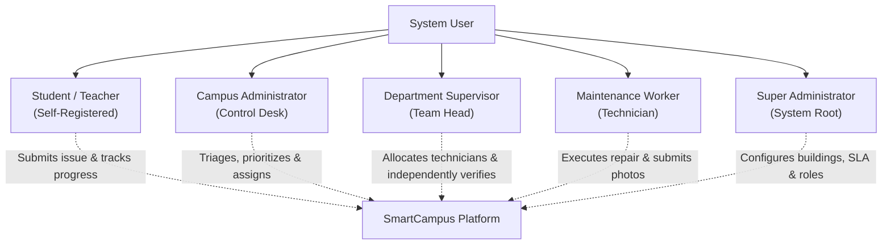
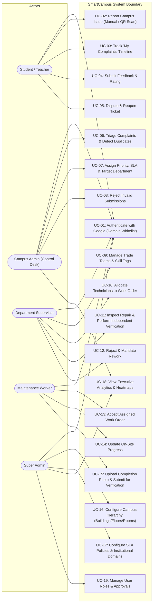
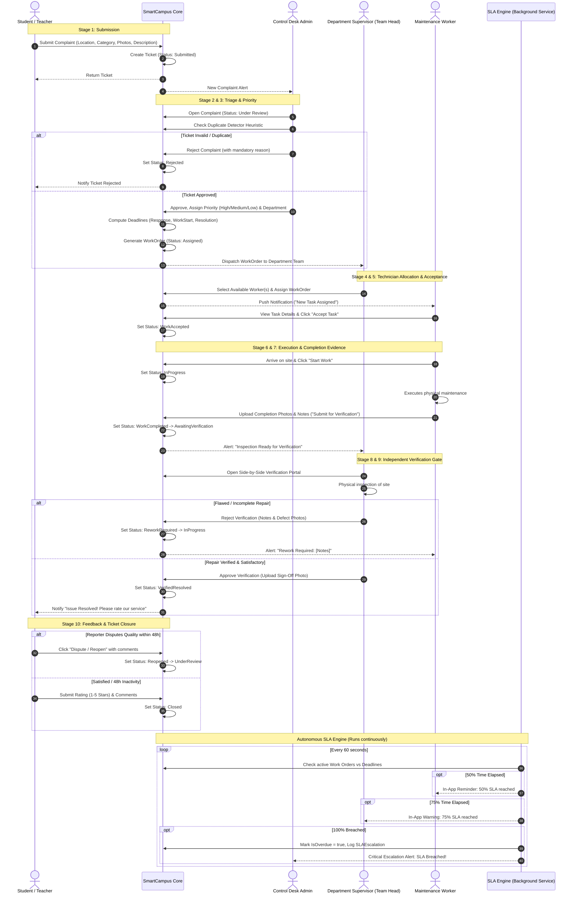
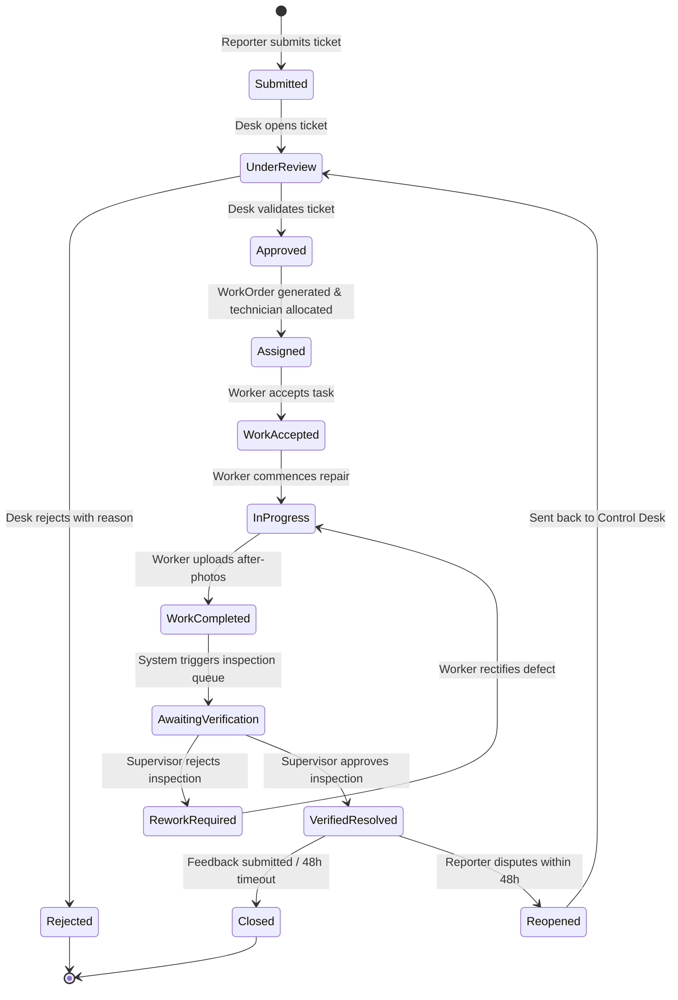

# Use Case Specifications & Workflow Models
## SmartCampus: Intelligent Campus Issue Reporting, Workforce Allocation & Resolution Verification System

**Document Version:** 1.0.0  
**Date:** 2026-11-12  
**Target Environment:** ASP.NET Core MVC (.NET 10 LTS), Entity Framework Core 10, SQL Server  

---

## 1. System Actors & Operational Hierarchy

---

## 2. Global System Use Case Diagram

---

## 3. End-to-End Complaint Lifecycle Sequence Diagram

---

## 4. State Transition Machine Specification

---

## 5. Detailed Use Case Specifications

### UC-01: Authenticate with Google & Institutional Domain Whitelist
- **Primary Actor:** Any User (Student, Faculty, Staff).
- **Preconditions:** User has a valid Google account.
- **Trigger:** User clicks "Continue with Google" on the login screen.
- **Main Success Scenario:**
  1. The user is redirected to the Google OAuth 2.0 authorization screen.
  2. The user grants permission. Google redirects back to the callback endpoint with an authorization code.
  3. The server exchanges the authorization code for an ID token and validates the signature, issuer, and audience.
  4. The server verifies `email_verified == true`.
  5. The server extracts the email domain (e.g., `lpu.co.in`) and queries the `AllowedEmailDomains` table.
  6. The domain is active and whitelisted.
  7. The system checks if the user exists in `AspNetUsers`. If not, it creates a new user with the default role `StudentTeacher`.
  8. The user session cookie is established, and the user is redirected to their role dashboard.
- **Alternative Scenarios:**
  - *5a. Domain not whitelisted:* The system terminates the session, logs an unauthorized registration attempt, and displays: "Your email domain is not authorized to access SmartCampus. Please use your official institutional email."
  - *4a. Email not verified on Google:* The system terminates the attempt and prompts the user to verify their email with Google.

---

### UC-02: Report Campus Issue (Manual / QR Code Scan)
- **Primary Actor:** Student / Teacher.
- **Preconditions:** User is authenticated.
- **Trigger:** User clicks "Report Issue" or scans a campus Location QR code.
- **Main Success Scenario:**
  1. If scanned via QR code, the URL parameter `locId={GUID}` automatically resolves and locks the Building, Floor, and Room.
  2. If navigated manually, the user selects Building from an interactive dropdown, selects Floor, and selects Room or Outdoor Zone.
  3. The user selects the Issue Category (e.g., Electrical -> Broken Switchboard).
  4. The user enters Title, Description, and an optional Contact Number.
  5. The user attaches 1 to 3 JPEG/PNG photos of the problem.
  6. The user clicks "Submit Issue".
  7. The server validates image headers (JPEG/PNG/WebP, max 10MB), persists the files under `wwwroot/uploads/complaints/{GUID}.jpg`, and writes the record to `Complaints` and `ComplaintImages`.
  8. A unique Ticket ID (`SC-YYYY-XXXXX`) is generated, initial status set to `Submitted`, and an entry logged in `ComplaintHistory`.
  9. The user is redirected to the Complaint Details page with a visual status timeline.
- **Alternative Scenarios:**
  - *7a. Invalid file uploaded (e.g., .exe, corrupted file, >10MB):* The server rejects the request with an error message and highlights the upload field.

---

### UC-03: Control Desk Complaint Triage & SLA Assignment
- **Primary Actor:** Campus Administrator (Control Desk).
- **Preconditions:** User has the `CampusAdmin` or `SuperAdmin` role.
- **Trigger:** Administrator reviews incoming submissions in the Triage Queue.
- **Main Success Scenario:**
  1. Administrator selects an incoming complaint with status `Submitted`. Status changes to `UnderReview`.
  2. The system runs the Duplicate Detector Heuristic: searches for complaints in the same location and category submitted in the last 24 hours.
  3. Administrator reviews images and description.
  4. Administrator sets Priority (`Critical`, `High`, `Medium`, `Low`).
  5. The system queries active `SLAPolicies` for the selected Priority and calculates `ResponseDeadline`, `WorkStartDeadline`, and `ResolutionDeadline`.
  6. Administrator selects the responsible maintenance Department (e.g., Electrical).
  7. Administrator clicks "Approve & Dispatch".
  8. The complaint transitions to `Approved`, a child `WorkOrder` is created, and status transitions to `Assigned`.
  9. An audit entry is recorded in `ComplaintHistory`.
- **Alternative Scenarios:**
  - *3a. Complaint is duplicate or invalid:* Administrator clicks "Reject", enters a mandatory rejection explanation. Status transitions to `Rejected`. A notification is sent to the reporter.

---

### UC-04: Department Work Order Generation & Technician Allocation
- **Primary Actor:** Department Supervisor (Team Head).
- **Preconditions:** User has `DepartmentSupervisor` role for the target department.
- **Trigger:** New Work Order appears in Department Queue.
- **Main Success Scenario:**
  1. Supervisor opens the pending Work Order.
  2. The system displays a roster of technicians in the supervisor's team, showing:
     - Worker Name & Contact
     - Verified Trade Skills (e.g., HVAC Specialist)
     - Current Active Workload (e.g., "1 active task — Available", "4 active tasks — Overloaded")
  3. Supervisor selects 1 or more technicians suitable for the task.
  4. Supervisor optionally specifies estimated completion target and instructions.
  5. Supervisor clicks "Assign Technicians".
  6. The system creates `WorkOrderAssignments` records, sets status to `Assigned`, and dispatches push/in-app notifications to assigned technicians.

---

### UC-05: Technician Task Execution & Evidence Submission
- **Primary Actor:** Maintenance Worker (Technician).
- **Preconditions:** User has `MaintenanceWorker` role and is assigned to the Work Order.
- **Trigger:** Technician logs into "My Tasks" mobile view.
- **Main Success Scenario:**
  1. Technician views assigned Work Order with issue details, location, and problem photos.
  2. Technician clicks "Accept Task". Status transitions to `WorkAccepted`.
  3. Technician reaches the site and clicks "Start Work". Status transitions to `InProgress`.
  4. Technician completes physical maintenance.
  5. Technician clicks "Complete Work" and is prompted for:
     - 1 to 3 "After-Repair" completion photos.
     - Work summary notes (materials replaced, repairs performed).
  6. Technician clicks "Submit for Verification".
  7. The server validates the photos and saves them.
  8. The Work Order status transitions to `WorkCompleted`, and the parent Complaint transitions to `AwaitingVerification`.
  9. The Department Supervisor is alerted for independent inspection.

---

### UC-06: Independent Physical Inspection & Verification Gate
- **Primary Actor:** Department Supervisor (Team Head).
- **Preconditions:** User has `DepartmentSupervisor` role. The supervisor MUST NOT be the assigned technician.
- **Trigger:** Work Order enters `AwaitingVerification` status.
- **Main Success Scenario (Approval):**
  1. Supervisor opens the Verification Queue and selects the pending task.
  2. The interface presents a Side-by-Side Comparison:
     - Left: Original problem photo submitted by reporter.
     - Right: Completion photo submitted by technician.
  3. Supervisor conducts on-site physical inspection to confirm the repair meets university safety and quality standards.
  4. Supervisor selects "Approve & Verify".
  5. Supervisor uploads an inspection verification photo (or confirmation stamp) and enters inspection sign-off remarks.
  6. The system records a `Verifications` row with `IsApproved = true`, `VerifierUserId = Supervisor.Id`, and UTC timestamp.
  7. The Work Order and parent Complaint transition to `VerifiedResolved`.
  8. The reporter is notified that the issue has been successfully resolved.
- **Alternative Scenario (Rejection & Rework):**
  - *4a. Work is substandard or incomplete:* Supervisor selects "Reject — Require Rework".
  - *4b.* Supervisor enters mandatory defect description and uploads a defect photo.
  - *4c.* The system records a `Verifications` row with `IsApproved = false`.
  - *4d.* The Work Order transitions to `ReworkRequired`, and status returns to `InProgress`.
  - *4e.* The assigned technician is alerted with the supervisor's specific rework directives.

---

### UC-07: Automated SLA Engine & Multi-Tier Escalation
- **Primary Actor:** System (Automated Background Service).
- **Preconditions:** System background scheduler is running.
- **Trigger:** Periodic execution timer (every 60 seconds).
- **Main Success Scenario:**
  1. The SLA engine queries all active Work Orders (`Assigned`, `WorkAccepted`, `InProgress`).
  2. For each work order, the engine computes:
     $$\text{PercentElapsed} = \frac{\text{CurrentTime} - \text{WorkOrder.CreatedAt}}{\text{ResolutionDeadline} - \text{WorkOrder.CreatedAt}} \times 100$$
  3. **Tier 1 (50% Elapsed):** If $\text{PercentElapsed} \ge 50\%$ and Tier 1 alert has not been triggered, the system generates an in-app reminder notification to the assigned technician.
  4. **Tier 2 (75% Elapsed):** If $\text{PercentElapsed} \ge 75\%$ and Tier 2 alert has not been triggered, the system generates an urgent warning notification to the Department Supervisor.
  5. **Tier 3 (100% Breached):** If $\text{CurrentTime} > \text{ResolutionDeadline}$ and not already logged:
     - Sets `WorkOrder.IsOverdue = true` and `Complaint.IsOverdue = true`.
     - Inserts an entry into `SLAEscalations` with timestamp and breach severity.
     - Sends immediate escalation notifications to Campus Control Desk and Super Administrator.

---

### UC-08: Campus Map Exploration & Issue Hotspots
- **Primary Actor:** Any Authenticated User / Campus Administrator.
- **Preconditions:** User is logged in.
- **Trigger:** User navigates to the "Campus Map" page.
- **Main Success Scenario:**
  1. The page initializes Leaflet.js centered on Lovely Professional University campus coordinates (`31.2536° N, 75.7037° E`).
  2. The system fetches GeoJSON / marker points for all university blocks (e.g., Block 32, Block 34, Central Library, UniMall, Hostels BH-1 to BH-8).
  3. Dynamic issue pins are overlaid on locations with active complaints, color-coded by urgency.
  4. The user clicks a pin: a popup displays the building name, number of active issues, highest priority level, and a link to view filtered complaints.
  5. Administrators can toggle the "Hotspot Heatmap" layer to visualize areas with recurring maintenance issues over the last 30/90 days.

---

### UC-09: Reporter Rating & Dispute Handling
- **Primary Actor:** Student / Teacher (Reporter).
- **Preconditions:** The complaint status is `VerifiedResolved`.
- **Trigger:** Reporter views resolved complaint notification.
- **Main Success Scenario (Satisfaction):**
  1. Reporter opens the Complaint Details page.
  2. Reporter selects a star rating (1 to 5 stars) and optionally enters comments.
  3. Reporter clicks "Submit Feedback".
  4. The system inserts a record into `ComplaintFeedbacks` and transitions the complaint status to `Closed`.
- **Alternative Scenario (Dispute within 48h):**
  - *2a. The reporter finds the issue is not fixed:* The reporter clicks "Dispute Resolution".
  - *2b.* The reporter enters reasons for reopening the ticket.
  - *2c.* The system changes status to `Reopened` and notifies the Control Desk for re-triage.
